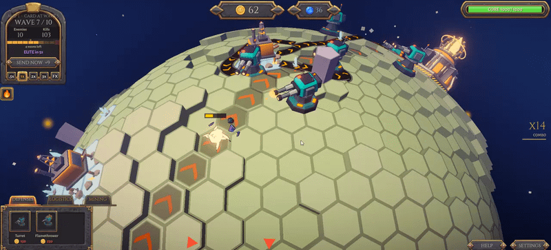
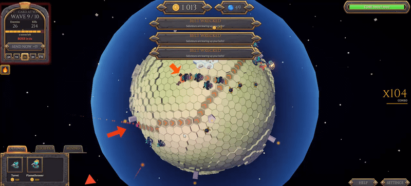
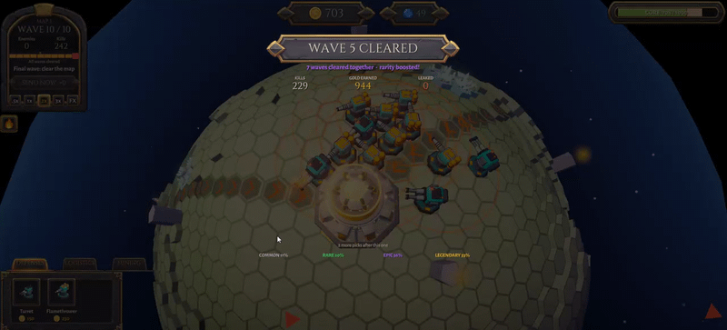

# Dungeon Conveyor

A roguelike tower-defense game built in Unity (C#). You defend your Core on a hex-tiled planet by placing miners, conveyor belts and towers while waves of rock creatures attack. Work in progress.

## Gameplay
- Build miners, belts and towers on a rotating hex planet, and keep your Core alive
- Enemies are rock critters and ore golems that hatch from meteors, chew your belts and slam your Core
- A boss arrives every 10th wave, with armour plates that break off as it takes damage
- After each cleared wave, pick 1 of 3 upgrade cards: elemental effects (fire, lightning, frost, poison) or stat boosts
- Maps get bigger as you clear stages

## Technical highlights
- Wave and boss system with a stage-based roguelike run
- Card/upgrade system with per-tower and global modifiers
- Code-driven animation rig for rigid-part models, with hit flash, cracks and crumble-on-death effects
- Element palettes for recolouring enemies at runtime
- Custom HUD with 9-sliced art and tweened feedback
- `PlaytestBot` that plays the game automatically for balance testing
- FMOD audio

Design notes for the larger systems are in [`docs/dev-notes`](docs/dev-notes).

## Team
- **Deyan Staykov**: programming. Most of the gameplay code, systems and architecture.
- **Alex**: art and 3D models, with occasional code contributions made with Claude Code.

Some assets, including a number of models, are currently AI-generated placeholders and will be replaced as the art develops. Parts of the code and documentation were also written with AI assistance and reviewed by the team.

## Run it
1. Install Unity 6000.3.22f1
2. Clone the repo and open it with Unity Hub
3. Open the `MainMenu` scene and press Play

## Status
Prototype. Known gaps: multi-core stages, audio polish, large-map performance.
